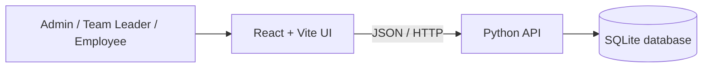

# FlowMetrics — Work Management

A lightweight, role-based task workflow demo built to make assignment, progress updates, and review visible in one place. The project is intentionally small enough to run locally without a database server or Python third-party packages.

> **Project status:** working educational MVP. This is not production-secure software. See [Security](SECURITY.md) before exposing it to the internet.

## What it demonstrates

- **Three roles:** Admin, Team Leader, and Employee.
- **Task assignment:** a Team Leader creates a task and assigns it to an employee.
- **Progress updates:** an employee moves a task from Assigned to In Progress and then Submitted.
- **Review loop:** the assigning Team Leader reviews the submission and leaves feedback.
- **Role-scoped task lists:** employees see their assigned tasks; Team Leaders see tasks they assigned; Admin sees all tasks.
- **Search, status summaries, due dates, and priority labels.**
- **Persistent local data:** SQLite stores users and tasks.

## Screenshots

Add genuine screenshots from your running application here before sharing the repository. Recommended captures: login page, Team Leader task list, create-task dialog, Employee task update, and Team Leader review. Do not use mock screenshots or include real personal data.

## Tech stack

| Layer   | Technology                          |
| ------- | ----------------------------------- |
| UI      | React 18, Vite, JavaScript, CSS     |
| API     | Python standard-library HTTP server |
| Storage | SQLite                              |
| Icons   | Lucide React                        |

## Architecture



## Run locally

### Requirements

- Python 3.12 recommended (standard library only for backend)
- Node.js 18 or newer and npm

### 1. Start the backend

From the repository root:

```powershell
cd backend
python main.py
```

Health check: <http://127.0.0.1:8000/api/health>

### 2. Start the frontend

Open a second terminal from the repository root:

```powershell
cd frontend
npm install
npm run dev
```

Open <http://localhost:5173>. If PowerShell blocks `npm.ps1`, use `npm.cmd install` and `npm.cmd run dev`.

### API URL configuration

By default the frontend calls `http://127.0.0.1:8000`. For a different API host, create `frontend/.env` based on `frontend/.env.example` and set `VITE_API_BASE_URL` to the backend origin (without `/api`). Restart Vite after changing it.

## Demo accounts

All demo accounts use `FlowMetrics@123`.

| Role        | Email                        |
| ----------- | ---------------------------- |
| Admin       | `admin@flowmetrics.local`    |
| Team Leader | `lead@flowmetrics.local`     |
| Employee    | `employee@flowmetrics.local` |

The demo database is created automatically at `backend/flowmetrics.db`. Delete that local file only when you intentionally want to reset demo data.

## Verify the workflow

1. Sign in as Team Leader and create a task assigned to Ravi Employee.
2. Sign out and sign in as Employee. Confirm the assignment appears.
3. Move it to In Progress, add an update, and submit it.
4. Sign in as Team Leader, review the submission, and save feedback.
5. Refresh and confirm the task and review remain saved.

Run the backend workflow smoke test from the repository root:

```powershell
python -m unittest discover -s backend/tests -v
```

Build the frontend:

```powershell
cd frontend
npm install
npm run build
```

## API overview

| Method     | Endpoint                 | Purpose                                  |
| ---------- | ------------------------ | ---------------------------------------- |
| GET        | `/api/health`            | Health check                             |
| POST       | `/api/login`             | Demo sign-in                             |
| POST       | `/api/logout`            | Sign out                                 |
| GET        | `/api/me`                | Current user                             |
| GET        | `/api/users`             | Employee directory for Admin/Team Leader |
| GET / POST | `/api/tasks`             | List or create tasks                     |
| PATCH      | `/api/tasks/{id}/update` | Employee progress update                 |
| PATCH      | `/api/tasks/{id}/review` | Leader/Admin review                      |
| DELETE     | `/api/tasks/{id}`        | Delete task (authorized roles)           |

## Known limitations

- Demo authentication uses simple seeded credentials and in-memory tokens.
- Tokens are lost when the backend restarts.
- The demo server is intended for local learning, not internet-facing production use.
- File attachments, email notifications, teams, analytics exports, and multi-tenant organization management are not implemented in this MVP.

## Roadmap

- [ ] Production authentication with hashed passwords and revocable sessions
- [ ] Team and organization management
- [ ] File uploads with access controls
- [ ] Activity history and audit trail
- [ ] Email/in-app notifications
- [ ] Automated frontend component and accessibility tests
- [ ] Production deployment with managed database and monitoring

## Contributing

Bug reports and focused pull requests are welcome. Read [CONTRIBUTING.md](CONTRIBUTING.md) first.

## License

MIT — see [LICENSE](LICENSE).
